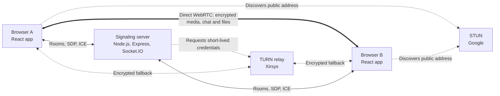

# ShareThings

**Private one-to-one video calls in the browser, with screen sharing, chat and resumable file transfer. Nothing to install, and no account needed to join.**

Audio, video, chat and files travel directly between the two browsers, or through an encrypted relay when a direct connection is impossible. The server only helps them find each other.

**Live:** https://sharethings-web.onrender.com

[Features](#features) · [Tech stack](#tech-stack) · [Architecture](#architecture) · [Engineering highlights](#engineering-highlights) · [Run it locally](#run-it-locally) · [Settings](#settings) · [Docker](#docker) · [Deploy](#deploy-on-render) · [Scaling](#scaling-optional) · [Privacy](#privacy) · [Project layout](#project-layout)

## Features

### Calls

- **HD video and audio:** camera up to 1280×720 at 30 fps, with mute, camera off, a call timer and a connection quality indicator.
- **Screen and camera together:** the other person sees your screen large and your camera small, and can swap them.
- **Adaptive quality:** Auto, High and Data saver modes. On a very weak connection, video pauses and audio continues.
- **Automatic reconnect:** a network drop restarts the connection, and your place in the call is kept for 30 seconds.
- **Flexible layout:** drag and resize the small video by mouse or touch, or pop the call out with picture-in-picture.
- **Call comforts:** speaker selection where the browser supports it, emoji reactions, a reminder when you talk while muted, and keyboard shortcuts.
- **Designed for every screen:** dark and light themes, phone and tablet layouts, and self-hosted Inter and Space Grotesk fonts.

### Joining and host controls

- **Join screen:** camera and microphone preview, device pickers, a microphone level meter and an optional network check.
- **Private room details:** before joining, you see only how many people are in the room, never their names.
- **Hard-to-guess rooms:** new meetings get a code of 10 random letters, like `abc-defg-hij`.
- **Ask to join:** the first person in is the host. Everyone else waits until the host admits or denies them.
- **Remove someone:** the host can remove the other person after a confirmation. A removed or denied tab stays out until the room is empty.
- **Host handover:** if the host really leaves, the remaining person becomes host and receives the waiting list.

### Chat and files

- **Chat over the call's own connection:** messages go browser to browser and are not stored on a server.
- **Large file transfer:** files are written to browser storage as they arrive, and checked block by block. Either side can pause or cancel, and only the side that paused can resume.
- **Survives interruptions:** where the browser has private file storage, an unfinished transfer continues after a dropped connection or a page reload.
- **Consent for big files:** files over 100 MB must be accepted before they are received.
- **Clipboard and drag and drop:** share text, links and images from the clipboard, or drop files onto the call.

### Sign-in and invites

- **Optional Google sign-in:** only needed to send email invites. It redirects to Google's own page and back.
- **Sign in without leaving a call:** during a call, sign-in opens in a separate tab.
- **Email invites:** sent through the Gmail API, with an optional meeting time in the sender's time zone and a calendar file.
- **Invite limits:** at most 5 per sender and 10 per network each hour, and 3 per recipient each day.

### Security and privacy

- **Room-scoped signaling:** call signals reach only the other person in the same room.
- **Waiting room isolation:** someone waiting receives no signaling, TURN credentials, names or IDs until admitted.
- **Abuse limits:** per-address limits on connections, joins, room checks and waiting requests.
- **Private-link verification:** a secret in the meeting link lets a browser check that its connection is with someone who has that link.
- **No third-party scripts:** all code, styles and fonts are served by the app, under a strict Content Security Policy.
- **Protected TURN account:** the Xirsys secret stays on the server. Browsers receive only short-lived TURN credentials.
- **No recording and no user database.**

## Tech stack

| Area | Technologies |
|---|---|
| **Frontend** | React 18, React Router 7, Vite 8, Tailwind CSS 3 (built with PostCSS) |
| **Real-time** | WebRTC (`RTCPeerConnection`, data channels, DTLS-SRTP), Socket.IO 4 |
| **Backend** | Node.js, Express 5 |
| **Browser APIs** | Origin Private File System, Web Workers, Web Crypto, Picture-in-Picture, Media Session |
| **Connectivity** | STUN (Google), TURN (Xirsys) |
| **Auth and email** | Google OpenID Connect, `google-auth-library`, Gmail API, Nodemailer's MIME composer |
| **Delivery** | Docker, Docker Compose, nginx, Render |

## Architecture



1. Both browsers connect to the signaling server and join a room. The server decides who is host and who must wait.
2. The server relays WebRTC offers, answers and ICE candidates only between the two people in that room.
3. The browsers connect directly when they can. On networks that block this, they use the TURN relay, which carries only encrypted traffic.
4. Audio, video, chat and files then flow over that connection and never pass through the signaling server.

## Engineering highlights

### 1. Fixed WebRTC lanes with `replaceTrack`

**Problem:** adding or removing tracks during a call forces a new offer and answer, which is one more thing that can fail in a live call.

**Solution:** the first offer creates a mic lane, a camera lane and a second video lane for the screen, plus two pre-negotiated data channels for chat and files. Sharing a screen or turning a device on or off then uses `replaceTrack` on an existing lane, with no renegotiation.

**Code:** `client/src/Services/peer.jsx`, `client/src/Pages/Room.jsx`

### 2. ICE restart and 30-second seat recovery

**Problem:** a network change should not end a call, and the media path and the signaling connection can fail separately.

**Solution:** recovery escalates in steps. A brief disconnect gets 4 seconds to heal, then up to four ICE restarts run with backoff, and finally one brand-new connection is attempted. Meanwhile the server holds the person's seat for 30 seconds, keyed to a random per-tab ID. The other person sees only a hash of that ID, so they cannot claim the seat.

**Code:** `client/src/Services/recovery.jsx`, `server/index.js`

### 3. Adaptive video quality

**Problem:** sending more video than the other screen shows wastes bandwidth, and a weak network can take the whole call down.

**Solution:** each side reports how large it displays the other's video, and the sender caps resolution and bitrate to match. After about 10 seconds of poor quality the camera drops to a 180p floor. If that still fails, camera video pauses while audio continues, and quality returns step by step. All of this uses `RTCRtpSender.setParameters` on the existing lanes.

**Code:** `client/src/Services/quality.js`

### 4. Resumable large file transfer

**Problem:** holding a large file in memory can crash a tab, and a dropped connection should not restart the transfer.

**Solution:** files move in 8 MB blocks, each verified with SHA-256. A Web Worker writes every block to the Origin Private File System through synchronous access handles. The receiver always says which block to send next, so pauses, damaged blocks, new connections and reloads all resume the same way. The sender stays at most two blocks ahead, which keeps memory flat and leaves priority for the call. Browsers without this storage keep files of up to 100 MB in memory instead.

**Code:** `client/src/Services/files.jsx`, `client/src/Services/opfsWorker.js`

### 5. Room-scoped signaling authorization

**Problem:** without checks, anyone with a socket could send an offer to another connection and try to receive its camera.

**Solution:** every relayed event is checked on the server: sender and target must share a room. People waiting to be admitted stay outside the Socket.IO room, so signaling cannot reach them. The server alone decides the host and checks every remove, admit and deny. Room codes use an internal prefix, so a code can never collide with Socket.IO's private per-connection rooms.

**Code:** `server/index.js`

### 6. Per-address limits on addresses that cannot be forged

**Problem:** rate limits are useless if a client can claim any IP address in a request header.

**Solution:** sliding-window limits use only the address set by trusted infrastructure: Cloudflare's `cf-connecting-ip` on Render, or the last `X-Forwarded-For` entry, which the bundled nginx overwrites. IPv6 clients are counted by their /64 block, and IPv4-mapped addresses are unwrapped, so one client cannot multiply its quota.

**Code:** `server/limits.js`, `client/nginx.conf`

### 7. Private-link verification over DTLS fingerprints

**Problem:** browsers exchange key fingerprints through the signaling server, so a dishonest server could swap them and sit in the middle of a call.

**Solution:** a new meeting link carries a 128-bit secret in its URL fragment, which browsers never send to a server. Each browser reads the certificates DTLS is really using, then sends an HMAC-SHA-256 proof over both fingerprints on the encrypted data channel. A middleman has different certificates and no secret, so it cannot produce a valid proof. A proof that does not match shows a warning. A proof that never arrives, which a middleman could cause by blocking it, shows "Not verified". Green means only that the other side has the link. The check relies on the page the browser loaded, and rooms joined by a typed code or an emailed invite stay marked as not verified.

**Code:** `client/src/Services/privateCheck.jsx`, `client/src/Services/roomSecret.jsx`

### 8. Google sign-in by redirect, verified on the server

**Problem:** a client must not be able to claim an identity, and Google's script should not run on a page that holds a room secret.

**Solution:** sign-in is a full-page OpenID Connect redirect with a random `state` and `nonce`. On return, the browser checks both and removes the token from the address bar. The server then verifies the token's signature and audience with `google-auth-library` and requires a verified email. Invites use only that server-verified identity.

**Code:** `client/src/useContext/AuthProvider.jsx`, `server/index.js`

### 9. No third-party scripts and a strict CSP

**Problem:** any script on the page could read the room secret from the URL.

**Solution:** Tailwind is compiled at build time, fonts are bundled with the app, and Google's script is gone. The Content Security Policy allows scripts only from the app's own origin and blocks plugins and framing. Inline styles are the one allowance.

**Code:** `client/nginx.conf`, `client/postcss.config.js`

## Run it locally

Needs Node.js 20.19+ or 22.12+.

```bash
git clone https://github.com/MeetAghara512/ShareThings.git
cd ShareThings

# Terminal 1: the signaling server on port 5001 (on macOS, port 5000 is taken by AirPlay)
cd server
npm ci
PORT=5001 npm start

# Terminal 2: the app on http://localhost:3000
cd client
npm ci
REACT_APP_SOCKET_SERVER_URL=http://localhost:5001 npm start
```

Open http://localhost:3000 in two browser windows to try a call. On Windows, or to avoid typing the variables each time, put them in `server/.env` (`PORT=5001`) and `client/.env.local` (`REACT_APP_SOCKET_SERVER_URL=http://localhost:5001`) and run just `npm start`.

## Settings

Server (in `server/.env`, read at start, or in the environment). All are optional:

| Variable | What it is for |
|---|---|
| `PORT` | Port to listen on (default `5000`) |
| `XIRSYS_IDENT`, `XIRSYS_SECRET`, `XIRSYS_CHANNEL` | TURN relay from your Xirsys account. Without them only STUN is used, and calls between some networks cannot connect |
| `GMAIL_CLIENT_SECRET`, `GMAIL_REFRESH_TOKEN` | Email invites, sent through the Gmail API |
| `INVITE_FROM_EMAIL` | Sender address for invites (default `sharethings.invites@gmail.com`) |
| `NODE_VERSION` | On Render only: the Node.js version to use, e.g. `22` |
| `REDIS_URL` | Keeps rate limits in Redis instead of the server's memory (see [Scaling](#scaling-optional)) |

App: `REACT_APP_SOCKET_SERVER_URL` is the signaling server's address; it is built into the app. Leave it unset when the app and the server are served from one address (the Docker setup below).

Google sign-in (only needed for email invites) redirects to Google and back, so each site's address with a trailing slash, such as `http://localhost:3000/`, must be listed under **Authorized redirect URIs** of the app's Google OAuth client. The sites allowed to use the server and to appear in invite links are listed in `ALLOWED_ORIGINS` in `server/index.js`; add yours there if you deploy somewhere else.

## Docker

```bash
docker compose up --build
```

Then open http://localhost:3000. nginx in the client container serves the app and passes `/socket.io/` and `/health` on to the server container, so the app needs no server address. The server's secrets come from your shell or from a `.env` file next to `docker-compose.yml`; they are never copied into an image.

## Deploy on Render

- **Server:** a Web Service with root directory `server`, build command `npm ci`, start command `npm start`, health check path `/health`, and the settings above as environment variables (`NODE_VERSION`, `XIRSYS_*`, `GMAIL_*`).
- **App:** a Static Site with root directory `client`, build command `npm ci && npm run build`, publish directory `build`, and `REACT_APP_SOCKET_SERVER_URL` set to the server's address. Also set:
  - **Redirects/Rewrites:** `/*` to `/index.html` as a Rewrite, so room links like `/room/abc-defg-hij` open the app.
  - **Headers** for path `/*`, with `<server host>` replaced by the server's host name (without it the app cannot reach the server):
    - `Content-Security-Policy`: `default-src 'self'; script-src 'self'; style-src 'self' 'unsafe-inline'; img-src 'self' data:; connect-src 'self' https://<server host> wss://<server host>; object-src 'none'; base-uri 'self'; form-action 'self'; frame-ancestors 'none'`
    - `X-Content-Type-Options`: `nosniff`
    - `Referrer-Policy`: `strict-origin-when-cross-origin`
    - `Permissions-Policy`: `camera=(self), microphone=(self), display-capture=(self)`

The free server sleeps when idle. The first visit wakes it, which can take up to a minute; the app says so while it waits.

## Scaling (optional)

Without `REDIS_URL` the server keeps its rate limits in memory, as before. With `REDIS_URL` set (for example `redis://localhost:6379`), the connection, join, room-check and invite limits are kept in Redis instead, so they survive a server restart. If Redis cannot be reached, calls keep working, limits are not enforced, an error is logged once a minute, and `/health` still answers `200` (saying Redis is down), so the host does not restart the server and cut calls. Rooms and calls still live in one server's memory, so run a single copy for now.

## Privacy

Calls are not recorded and there is no user database. See the [Privacy Policy](client/public/privacy.html) and [Terms of Service](client/public/terms.html), served at `/privacy.html` and `/terms.html`.

## Project layout

```
client/                React app (Vite), nginx.conf and Dockerfile
  public/              icons, Privacy Policy, Terms of Service
  src/Pages/           screens and call interface
  src/Services/        WebRTC, recovery, video quality, chat, file transfer, private check
  src/useContext/      socket connection and Google sign-in
server/
  index.js             signaling (Socket.IO), rooms, seats and host controls
  limits.js            per-address limits
  store.js             where limits are kept: memory, or Redis with REDIS_URL
  turn.js              TURN credentials from Xirsys, shared for a few minutes
  invite.js            email invites (Gmail API)
  stats.js             live counter for the first page
docker-compose.yml
```
